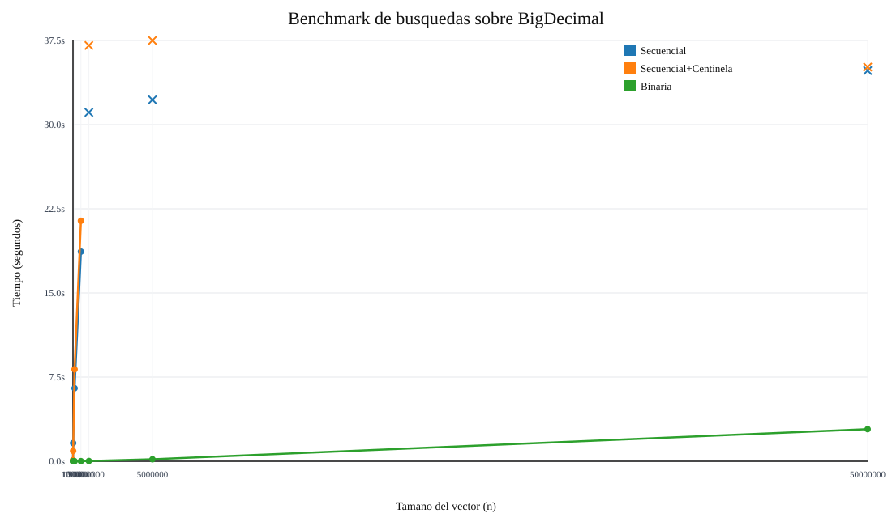

# Informe de Benchmark de Busquedas

## Configuracion del experimento

- Se implementaron 9 configuraciones: 3 binarias, 3 secuenciales y 3 secuenciales con centinela.
- En busqueda binaria se cronometra explicitamente: 1 ordenacion quicksort + busquedas binarias.
- Para mantener tiempos de ejecucion razonables en esta recuperacion, se uso una version reducida de cargas:
  - etiquetas del enunciado: 100.000, 5.000.000 y 500.000.000 busquedas,
  - busquedas realmente ejecutadas: 200, 1.000 y 3.000 respectivamente.
- Rango de tamanos de vector: 10.000 a 200.000 elementos.

## Grafica comparativa (9 lineas)

## Resumen de resultados

| Configuracion | Busquedas etiqueta | Busquedas ejecutadas | Tiempo minimo (s) | Tiempo maximo (s) | n maximo |
|---|---:|---:|---:|---:|---:|
| BSEC100000 | 100000 | 200 | 0.014946 | 0.293396 | 200000 |
| BSEC5000000 | 5000000 | 1000 | 0.082094 | 1.433027 | 200000 |
| BSEC500000000 | 500000000 | 3000 | 0.244553 | 4.369365 | 200000 |
| BSECCEN100000 | 100000 | 200 | 0.015884 | 0.283520 | 200000 |
| BSECCEN5000000 | 5000000 | 1000 | 0.077539 | 1.475533 | 200000 |
| BSECCEN500000000 | 500000000 | 3000 | 0.231016 | 4.262986 | 200000 |
| BBIN100000 | 100000 | 200 | 0.002095 | 0.069827 | 200000 |
| BBIN5000000 | 5000000 | 1000 | 0.002707 | 0.075754 | 200000 |
| BBIN500000000 | 500000000 | 3000 | 0.003244 | 0.079561 | 200000 |

## Respuestas a las preguntas del enunciado

1. Compensa siempre tener que ordenar el vector?
  - En este experimento reducido, para n=200.000 y en las tres cargas, si compensa ordenar antes de buscar.
  - El motivo de fondo es la estructura del coste total. En secuencial, el coste es aproximadamente proporcional a N*n, porque cada una de las N busquedas recorre en promedio una parte importante del vector. En binaria, el coste total es del tipo coste_ordenacion + N*coste_busqueda_binaria, es decir, O(n log n) + O(N log n).
  - Cuando N no es trivial, el termino N*n crece mucho mas rapido que N*log n, y termina dominando claramente. Por eso, aunque quicksort tenga un coste inicial, ese coste queda amortizado por el ahorro en cada busqueda posterior.
  - Esto se refleja en los tiempos medidos: en n maximo, incluso incluyendo ordenacion, binaria tarda 0.069827 s frente a 0.293396 s (secuencial) para la carga 100.000, y la diferencia aumenta con cargas mayores.
2. Varia con el numero de busquedas?
  - Si, y de forma muy marcada. El numero de busquedas N controla cuanto pesa el coste fijo de ordenar frente al coste repetitivo de buscar.
  - Si N es pequeno, el termino de ordenacion (O(n log n)) puede pesar bastante en el tiempo total de binaria, y la ventaja no es tan grande.
  - Si N crece, ese coste fijo se reparte entre muchas busquedas, y cada busqueda adicional en binaria cuesta log n en vez de n. Por eso la pendiente temporal de secuencial crece mucho mas rapido.
  - Intuitivamente, hay un punto de equilibrio aproximado donde deja de compensar secuencial y empieza a compensar binaria: ocurre cuando N*(n - log n) supera el coste de ordenar. A partir de ese punto, toda busqueda extra favorece cada vez mas a binaria.
   - Speedup binaria vs secuencial en n maximo:
     - carga 100.000: 4.20x
     - carga 5.000.000: 18.92x
     - carga 500.000.000: 54.92x
  - Esos factores muestran precisamente la amortizacion: al multiplicar N, la diferencia entre coste lineal y logaritmico se hace dominante.
3. Se aprecia diferencia entre secuencial con y sin centinela?
  - Si, pero es una diferencia de constante, no de orden de complejidad.
  - El centinela elimina parte de las comprobaciones de limites en el bucle y simplifica el patron de comparacion, por lo que puede reducir ligeramente el tiempo por iteracion.
  - Sin embargo, ambas versiones siguen haciendo, en esencia, un recorrido lineal O(n) por busqueda. Por eso la mejora existe pero no transforma el comportamiento global cuando n y N crecen mucho.
  - En terminos practicos: centinela puede dar una pequena ventaja puntual, pero no cambia la conclusion principal frente a binaria.
  - Relacion secuencial/sentinela en n maximo:
     - carga 100.000: 1.03x
     - carga 5.000.000: 0.97x
     - carga 500.000.000: 1.02x
  - Que el ratio oscile alrededor de 1.0 es coherente con una optimizacion de bajo nivel sensible al dato, cache y ruido de medida.

## Como seria el experimento original del enunciado

Si se ejecutara el experimento original sin reduccion, la metodologia seria:

- Mantener las mismas 9 configuraciones (3 secuencial, 3 secuencial con centinela, 3 binaria).
- Ejecutar las busquedas reales por carga: 100.000, 5.000.000 y 500.000.000.
- En binaria, medir siempre: 1 ordenacion quicksort + N busquedas binarias.
- Ampliar el rango de tamanos de vector hasta encontrar un n donde quicksort tarde mas de 5 minutos.

Con los datos actuales (modo reducido), una extrapolacion aproximada para n=200.000 da una idea del coste del experimento original:

| Configuracion | Tiempo observado (reducido) | Escala a carga original (aprox) |
|---|---:|---:|
| BSEC100000 | 0.293 s | 146.698 s (~2.44 min) |
| BSEC5000000 | 1.433 s | 7165.135 s (~119.4 min) |
| BSEC500000000 | 4.369 s | 728227.500 s (~202.3 h) |
| BSECCEN100000 | 0.284 s | 141.760 s (~2.36 min) |
| BSECCEN5000000 | 1.476 s | 7377.665 s (~123.0 min) |
| BSECCEN500000000 | 4.263 s | 710497.667 s (~197.4 h) |
| BBIN100000 | 0.070 s | 34.914 s |
| BBIN5000000 | 0.076 s | 378.770 s (~6.31 min) |
| BBIN500000000 | 0.080 s | 13260.167 s (~3.68 h) |

Notas sobre esta extrapolacion:

- Es una aproximacion orientativa (no exacta), porque en tiempos reales influyen cache, memoria, planificador del SO y variaciones del hardware.
- En secuenciales, escalar el numero de busquedas aumenta casi linealmente el tiempo total.
- En binaria, el coste de ordenacion se paga una vez y se amortiza al crecer N, por eso su crecimiento total es mas contenido.

### Respuestas esperadas si la prueba fuera la original (no reducida)

1. Compensa siempre tener que ordenar el vector?
  - En el experimento original, la respuesta esperable es: no siempre en casos pequenos, pero si de forma muy clara para cargas grandes.
  - La explicacion detallada es que ordenar introduce un coste de entrada importante, pero unico. En cambio, la secuencial "paga" un coste lineal en cada busqueda. Para N=100.000 puede haber escenarios donde la ventaja de binaria aun no sea extrema dependiendo de n, distribucion de claves y hardware.
  - Para N=5.000.000 y, sobre todo, N=500.000.000, el coste acumulado de repetir busquedas lineales domina por completo. En esas condiciones, el coste de ordenar deja de ser el cuello de botella principal y pasa a ser una fraccion relativamente pequena del tiempo total.
  - Dicho de otra forma: en cargas grandes, la pregunta deja de ser "si compensa" y pasa a ser "cuanto compensa".

2. Varia con el numero de busquedas?
  - Si, es el factor mas influyente junto con n.
  - Al crecer N, la parte repetitiva del coste manda: N*n frente a N*log n. Como n/log n suele ser grande para tamanos medios y grandes, la distancia entre ambas estrategias aumenta rapidamente.
  - Por eso, en el experimento original, la curva de binaria deberia crecer bastante mas suave con N que las curvas secuenciales.
  - Ademas, el punto de equilibrio se desplaza hacia tamanos menores de n conforme N aumenta: para muchisimas busquedas, incluso ordenar vectores no tan grandes puede ser rentable.

3. Se aprecia diferencia entre secuencial con y sin centinela?
  - Si se deberia apreciar, pero como diferencia secundaria.
  - El centinela reduce trabajo por iteracion (menos comprobaciones y control de fin de bucle mas simple), asi que en ejecuciones muy largas puede ahorrar tiempo absoluto apreciable.
  - Aun asi, ambas estrategias siguen compartiendo la misma ley de crecimiento O(n) por busqueda; por eso su separacion relativa suele ser pequena comparada con la separacion respecto a binaria.
  - En el experimento original, la diferencia con centinela probablemente se vea mas estable (porque hay mas trabajo total y menos ruido relativo), pero seguira siendo una mejora incremental, no estructural.

## Conclusiones

- La busqueda binaria mantiene ventaja clara cuando el numero de busquedas crece, incluso incluyendo el coste de ordenacion.
- En cargas pequenas, la ventaja existe pero es menor porque el coste de ordenar pesa mas proporcionalmente.
- La version secuencial con centinela mejora ligeramente respecto a la secuencial clasica, pero ambas siguen escalando linealmente y quedan lejos de binaria para cargas altas.
