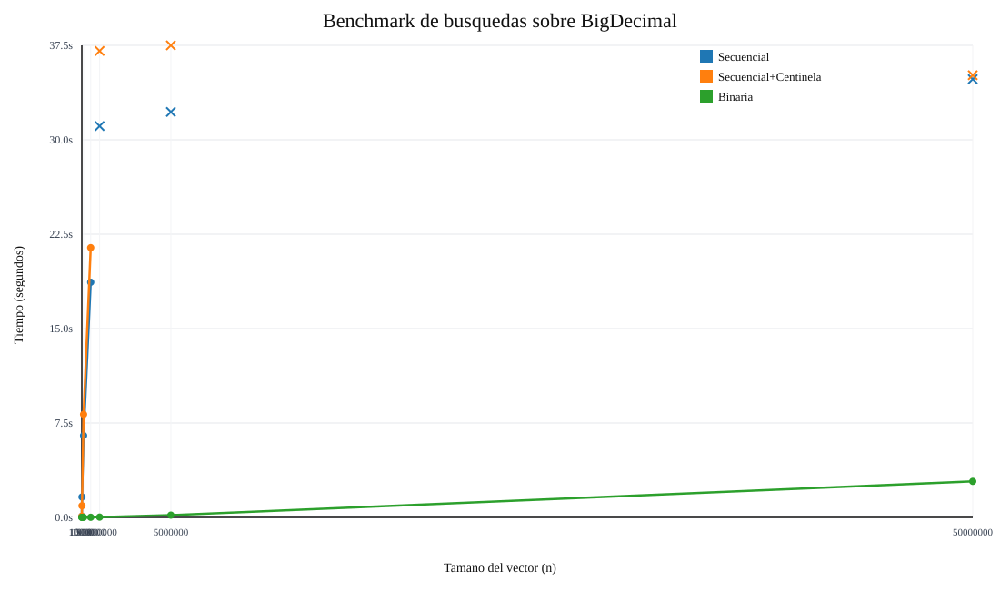

# AlgoritmosBusqueda (BigDecimal + benchmark de 9 configuraciones)

Proyecto actualizado para comparar algoritmos de búsqueda con:

- Medición de tiempo con `timespec_get()` (nanosegundos).
- 9 configuraciones: 3 secuenciales, 3 secuenciales con centinela y 3 binarias.
- En binaria se cronometra: `1 ordenación quicksort + búsquedas`.
- Modo reducido para ejecutar rápido en recuperación.

## Nombres de archivos (estándar snake_case)

- `big_decimal.c`, `big_decimal.h`
- `dynamic_vector.c`, `dynamic_vector.h`
- `search.c`, `search.h`
- `quick_sort.c`, `quick_sort.h`
- `tests/test_suite.c`

## Ejecutar tests

Linux/WSL:

```bash
make check
```

Windows PowerShell:

```powershell
./run_tests.ps1
```

## Ejecutar benchmark

Linux/WSL:

```bash
make benchmark
```

Salida DAT (en `results/`):

- `BSEC100000.DAT`, `BSEC5000000.DAT`, `BSEC500000000.DAT`
- `BSECCEN100000.DAT`, `BSECCEN5000000.DAT`, `BSECCEN500000000.DAT`
- `BBIN100000.DAT`, `BBIN5000000.DAT`, `BBIN500000000.DAT`

Formato de cada DAT (CSV con cabecera):

`n,searches_label,searches_executed,time_seconds`

## Gráfica e informe comparativo en Markdown

No requiere dependencias externas de Python.

Acceso directo al informe:

- [INFORME.md](INFORME.md)

Vista rápida de la gráfica:



Generar gráfica e informe desde DAT existentes:

```bash
python3 plot_benchmarks.py
```

Ejecutar benchmark + gráfica + informe en un solo paso:

```bash
python3 plot_benchmarks.py --run-cmd "./build/bench/benchmark --all"
```

Archivos generados:

- `results/benchmark_plot.svg`
- `results/benchmark_report.md`

## Notas de ejecución

- Si ejecutas `build/bench/benchmark` sin argumentos, se abre un menú interactivo (9 opciones).
- Para automatizar generación de todos los ficheros usa `build/bench/benchmark --all`.

## Complejidad teórica

- Búsqueda secuencial: CPU `O(n)`, memoria extra `O(1)`.
- Búsqueda secuencial con centinela: CPU `O(n)`, memoria extra `O(1)`.
- Búsqueda binaria: CPU `O(log n)` para buscar (si ya está ordenado), memoria extra `O(1)` en la búsqueda.
