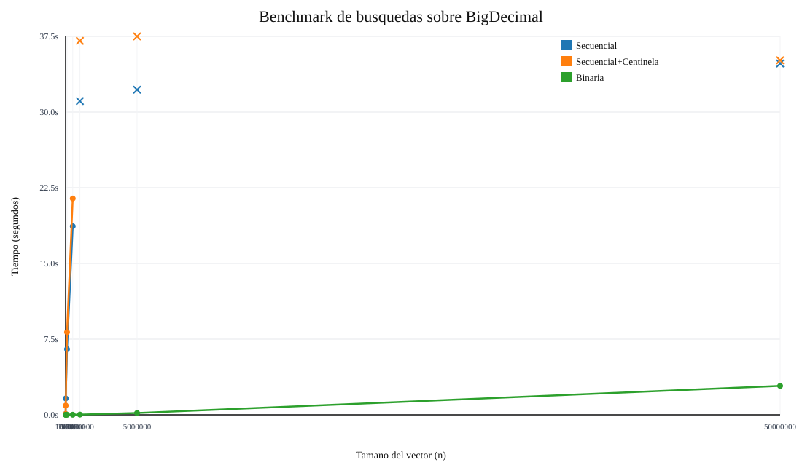

# Informe de Benchmark de Búsquedas

## Configuración

- Medición temporal: `timespec_get()` con precisión de nanosegundos.
- Tamaño máximo objetivo del vector: 50.000.000 elementos.
- Búsquedas máximas por ejecución: 1.000.000.
- Timeout automático por ejecución: 30 segundos.

## Gráfica comparativa

## Resumen observado

| Algoritmo | Ejecuciones OK | Timeouts | Fallos de memoria | Tiempo medio (s) | n máximo completado |
|---|---:|---:|---:|---:|---:|
| Secuencial | 4 | 3 | 0 | 6.729101 | 500000 |
| Secuencial + Centinela | 4 | 3 | 0 | 7.661939 | 500000 |
| Binaria | 7 | 0 | 0 | 0.441474 | 50000000 |

## Complejidad general (CPU y memoria)

| Algoritmo | CPU (promedio) | Memoria extra |
|---|---|---|
| Búsqueda secuencial | O(n) | O(1) |
| Búsqueda secuencial con centinela | O(n) | O(1) |
| Búsqueda binaria (vector ordenado) | O(log n) búsqueda, O(n log n) ordenación previa | O(1) in-place (quicksort promedio) |

## Conclusiones

1. La búsqueda binaria escala mejor en CPU para tamaños grandes, siempre que el vector esté previamente ordenado.
2. La secuencial con centinela mantiene complejidad O(n), pero reduce comprobaciones en el bucle interno y suele mejorar ligeramente tiempos.
3. En memoria extra, los tres métodos de búsqueda son O(1); el coste principal de memoria en este proyecto proviene del almacenamiento del propio vector de `BigDecimal`.
4. El timeout de 30 s evita ejecuciones descontroladas y permite comparar algoritmos de forma reproducible en hardware actual.
